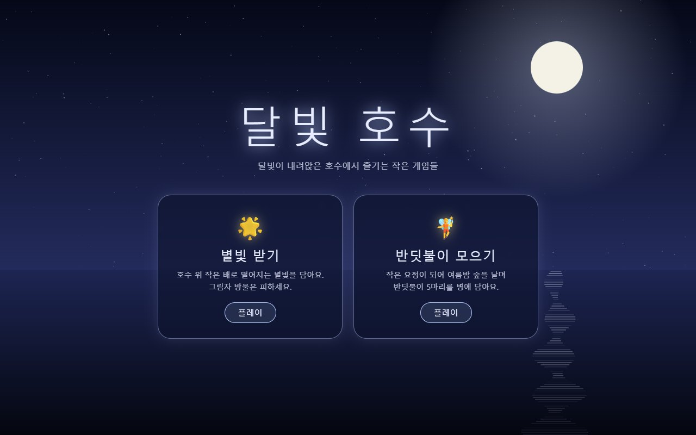
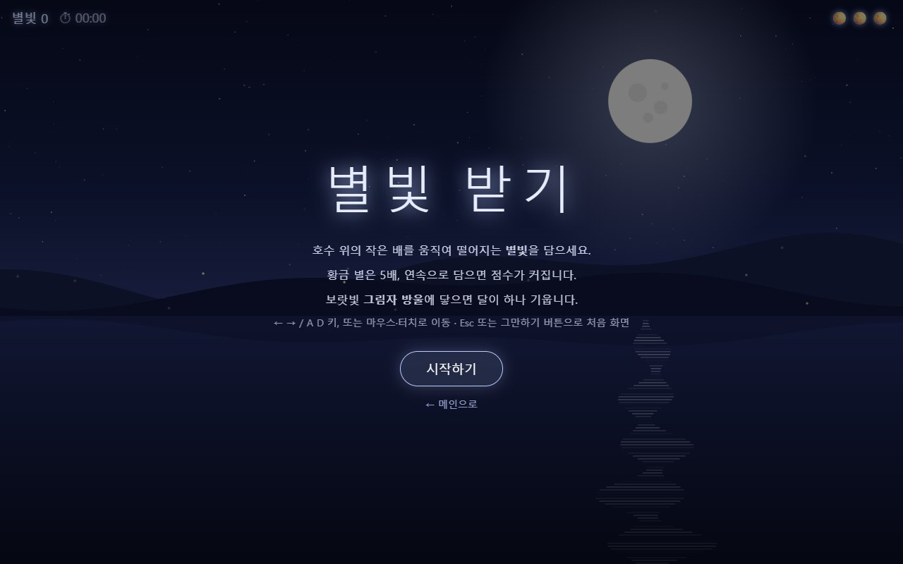
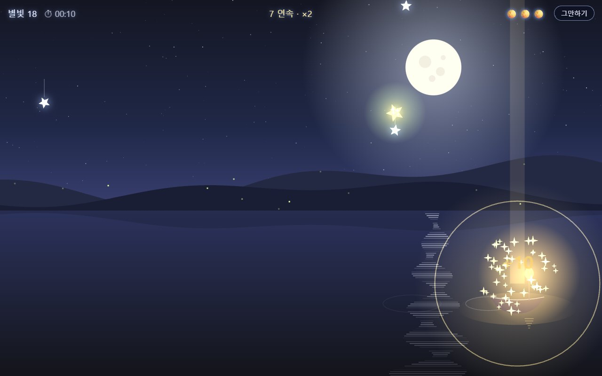
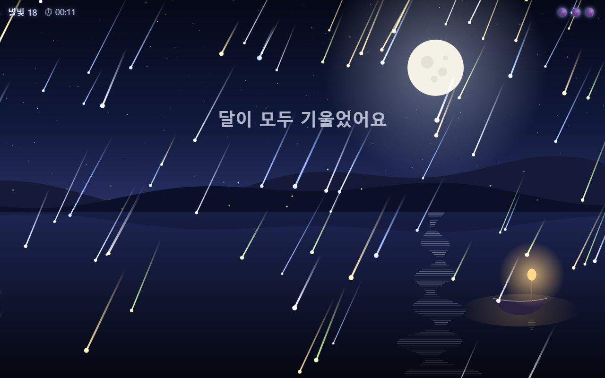

# 달빛 호수 (dalbit-lake)

달빛이 내려앉은 호수에서 즐기는 작은 웹 게임 모음입니다.
"바이브 코딩으로 웹 서비스 개발하기" 과정의 *HTML·CSS·JavaScript — 웹페이지를 이루는 세 겹* 과제로 만들었습니다.

👉 **https://eple-lab.github.io/dalbit-lake/**



## 게임

| 게임 | 설명 | 플레이 | 문서 |
| --- | --- | --- | --- |
| 🌟 별빛 받기 | 호수 위 작은 배로 떨어지는 별빛을 담는 2D 게임 | [starlight/](https://eple-lab.github.io/dalbit-lake/starlight/) | [README](starlight/README.md) |
| 🧚 반딧불이 모으기 | 작은 요정이 되어 숲을 날며 반딧불이 5마리를 병에 담는 3D 게임 | [fireflies/](https://eple-lab.github.io/dalbit-lake/fireflies/) | [README](fireflies/README.md) · [PRD](docs/fireflies-prd.md) |

메인 화면의 카드를 누르면 각 게임으로 가고, 게임의 처음 화면에서 "← 메인으로"를 누르면 돌아옵니다.

## 화면 미리보기

### 🌟 별빛 받기

| 시작 화면 | 황금 별을 받는 순간 "화악" | 달이 모두 기울면 별이 쏟아지는 엔딩 |
| --- | --- | --- |
|  |  |  |

### 🧚 반딧불이 모으기

| 시작 화면 | 용에게 날아가기 (오른쪽 위 작은 창에 요정) |
| --- | --- |
|  |  |
| **반딧불이가 손등에 앉는 순간** | **두 손 모아 투명한 병에 담기** |
|  |  |

## 폴더 구성

```
dalbit-lake/
├─ index.html          메인 화면 (게임 선택 카드)
├─ starlight/          별빛 받기
│  ├─ index.html
│  └─ README.md
├─ fireflies/          반딧불이 모으기 (HTML·CSS·JS 세 파일로 분리)
│  ├─ index.html
│  ├─ styles.css
│  ├─ script.js
│  └─ README.md
├─ docs/
│  ├─ images/         README 화면 캡처
│  └─ fireflies-prd.md   반딧불이 모으기 기획 문서 (인터뷰로 확정한 결정 기록 포함)
└─ fireflies-request.md  반딧불이 모으기 처음 요청문 (과제 템플릿 형식)
```

## 내 컴퓨터에서 열기

- 별빛 받기: `starlight/index.html`을 더블클릭하면 바로 열립니다.
- 메인 화면과 반딧불이 모으기도 더블클릭으로 열 수 있습니다. 반딧불이 모으기는 3D 라이브러리를 인터넷에서 불러오므로 인터넷 연결이 필요합니다.
- 폴더 링크까지 웹과 똑같이 확인하려면 간단한 로컬 서버를 띄웁니다.

```bash
python -m http.server 8000
```

그다음 브라우저에서 http://localhost:8000 을 엽니다.

## 배포

`main` 브랜치에 푸시하면 GitHub Pages가 1~2분 뒤 자동으로 반영합니다 (Source: Deploy from a branch, `main` / root).

## 만든 과정

1. **별빛 받기**: 채팅으로 첫 게임을 만들고, 플레이하며 "그만하기 버튼", "화악 퍼지는 효과", "별이 쏟아지는 엔딩", "황금 별 더 자주"처럼 한 번에 하나씩 다시 요청했습니다.
2. **반딧불이 모으기**: 과제 템플릿으로 요청문을 쓰고, 코드를 만들기 전에 인터뷰로 PRD를 확정했습니다 (시점, 조작 키, 나무에 앉기, 3분 뒤 계속하기, 용의 역할 등). 그다음 PRD대로 만들었습니다.
3. 모든 변경은 커밋으로 남겨 두었습니다: [커밋 기록](https://github.com/eple-lab/dalbit-lake/commits/main)
