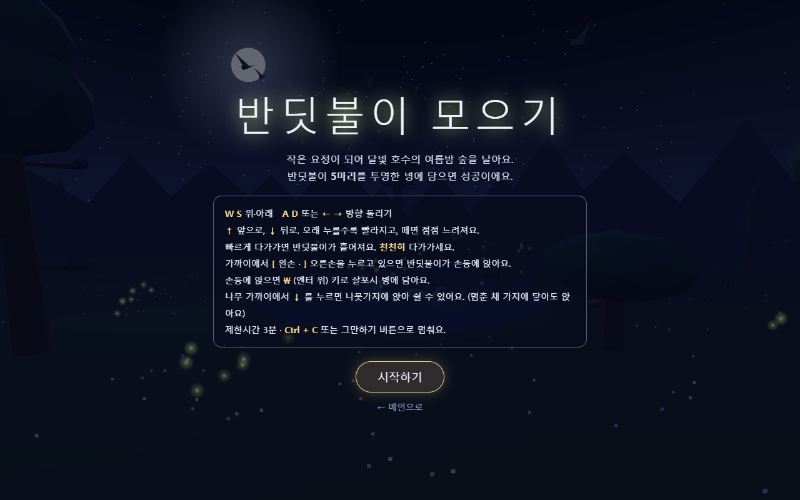
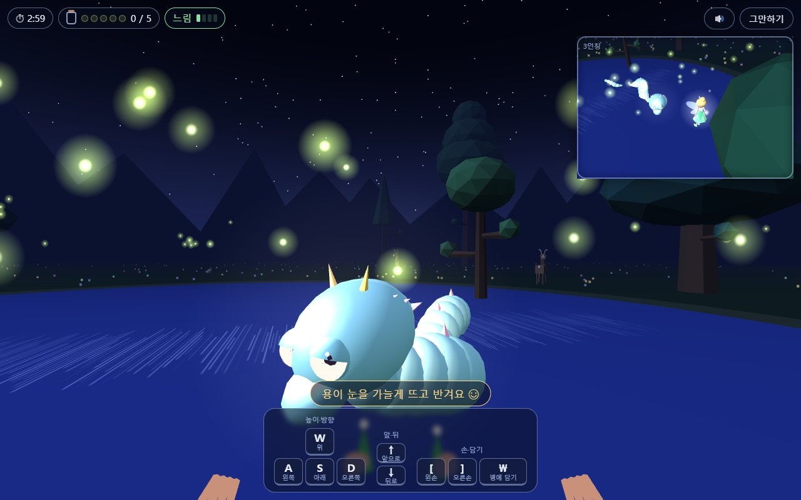
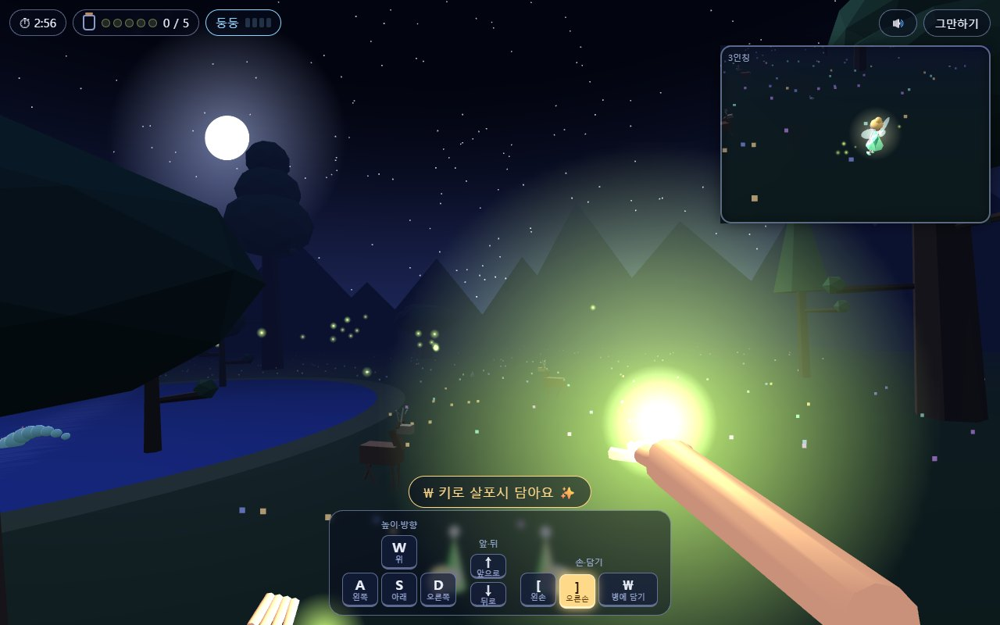
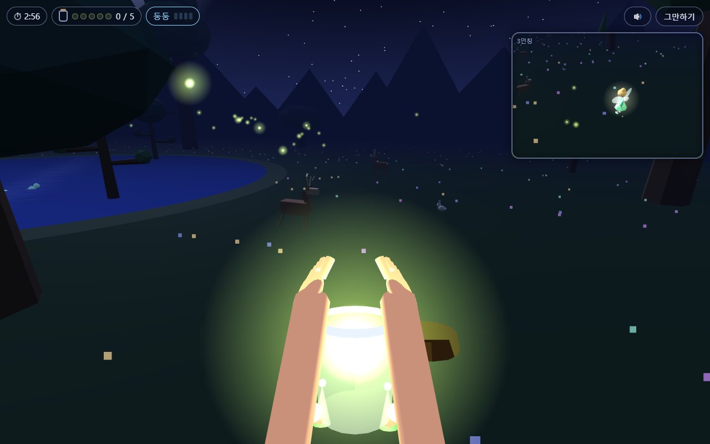

# 반딧불이 모으기

작은 요정(가칭 "팅커벨")이 되어 달빛 호수의 여름밤 숲을 날며, 반딧불이 5마리를 투명한 유리병에 담는 3D 게임입니다.

👉 플레이: https://eple-lab.github.io/dalbit-lake/fireflies/

- 기획 문서(PRD): [../docs/fireflies-prd.md](../docs/fireflies-prd.md)
- 처음 요청문: [../fireflies-request.md](../fireflies-request.md)

## 화면

- **메인 화면**: 요정의 눈으로 보는 1인칭 3D. 손끝과 발끝이 은근히 보입니다.
- **오른쪽 위 작은 창**: 요정의 왼쪽 위에서 비스듬히 내려다보며 따라가는 3인칭 화면 (요정이 창의 약 1/5).
- 작은 호수 가운데에는 지렁이처럼 꿈틀거리는 온화한 수호신 용이 헤엄쳐요. 큰 눈을 위·아래 눈꺼풀로 깜박이고, 가까이 가면 요정을 쳐다봐요. 땅 위에는 나무 12그루, 호수에는 물속에서 솟은 작은 나무 세 그루가 있고, 반딧불이는 70마리예요. 사슴·토끼·새가 돌아다닙니다.

**시작 화면**

**용에게 날아가기** — 반딧불이가 모여 있는 용 곁으로. 오른쪽 위 작은 창에는 3인칭으로 본 요정이 보여요.

**반딧불이가 손등에 앉는 순간** — ] 오른손을 내밀면 반딧불이가 크고 밝게 빛나며 날아와 앉고, 손을 연둣빛으로 비춰요.

**두 손 모아 병에 담기** — \ 를 누르면 몸을 웅크려 두 손으로 감싸고 투명한 병에 넣어요. (이 캡처만 아래 키 안내를 숨겼어요)

## 조작

| 키 | 동작 |
| --- | --- |
| W / S | 위로 / 아래로 |
| A / D, ← / → | 왼쪽 / 오른쪽으로 방향 돌리기 |
| ↑ / ↓ | 앞으로 / 뒤로 — 오래 누를수록 빨라지고, 떼면 점점 느려짐. 나무 가까이에서 ↓ 는 가지에 앉기 |
| [ / ] | 왼손 / 오른손 내밀기 (누르고 있는 동안) |
| \ (엔터 위, 한글 글꼴에서는 ₩) | 손등의 반딧불이를 병에 담기 |
| Ctrl + C, Esc, 오른쪽 위 "그만하기" | 계속할까요 / 그만할까요 창 |

휴대폰에서는 화면 아래 키 버튼을 손가락으로 누릅니다.

## 규칙

1. **천천히 다가가기**: 빠른 속도(빠름, 주황)로 다가가면 반딧불이가 흩어집니다.
2. **손 내밀기**: 근처에 반딧불이가 있으면 "손을 올려보세요" 안내가 나옵니다. [ 또는 ]를 누르고 있으면 가장 가까운 반딧불이가 크고 밝게 빛나며 손을 비추고 천천히 날아와 손등에 앉습니다.
3. **병에 담기**: 손등에 앉으면 \ 를 누릅니다. 몸을 웅크려 두 손으로 감싸고 투명한 병에 넣습니다.
4. **따콩!**: 나무에 부딪히면 소리와 함께 튕겨 나가고 1초 비틀거립니다. 손등의 반딧불이만 날아가고 병 속 반딧불이는 그대로입니다.
5. **쉬기**: 나무 가까이에서 "↓ 아래 방향키를 눌러보세요" 안내가 나오면 ↓ 로 가지에 앉습니다. 멈춘 채 가지에 닿아도 앉아요. 이동 키나 ↑ 를 누르면 다시 날아오릅니다.
6. **용**: 반딧불이는 용을 좋아해 그 곁에 많이 모입니다. 다가가면 용이 쳐다보며 눈을 살짝 가늘게 뜨고 반깁니다.
7. **끝**: 5마리를 담으면 성공. 제한시간 3분이 되면 계속할지 묻고, 계속하면 3분을 더 줍니다.

## 파일 (세 겹)

| 파일 | 겹 | 내용 |
| --- | --- | --- |
| `index.html` | 구조 | 시작·멈춤·성공 화면, 위쪽 정보, 아래 키 안내 |
| `styles.css` | 표현 | 색, 배치, 눌린 키 표시, 따콩 애니메이션, 휴대폰 크기 |
| `script.js` | 동작 | Three.js 3D 장면, 비행, 반딧불이, 손·병 동작, 소리, 진행 |

- 3D: [Three.js](https://threejs.org/) r128을 CDN에서 불러옵니다. 이미지·모델 파일 없이 도형을 코드로 조합했습니다.
- 소리: 파일 없이 브라우저(Web Audio)에서 만듭니다.

## 변경 기록

| 날짜 | 내용 |
| --- | --- |
| 2026-10-28 | PRD 인터뷰로 규칙 확정 |
| 2026-10-28 | 첫 버전 |
| 2026-10-28 | 플레이 후 수정: 맵·호수 줄이기, 지렁이 같은 용과 눈 깜박임, 속도 변화 3배 + 손 떼면 점점 느려짐, 작은 창 왼쪽 위 시점, 더 큰 둥둥, 다가오는 반딧불이 크고 밝게, 손 올리기 안내, 호수 섬 나무, 다가오는 거리 2배 |
| 2026-10-28 | 플레이 후 수정 2: 용 눈꺼풀 깜박임과 쳐다보기, 나무 12그루 + 물에서 솟은 나무, ↑ 앞으로 ↓ 뒤로, ↓ 로 나무에 앉기 안내, 반딧불이 70마리, 손으로 오는 반딧불이 더 밝게 |
| 2026-10-28 | 반딧불이가 빨랐다 느렸다 하며 더 활발하게 날기 |
